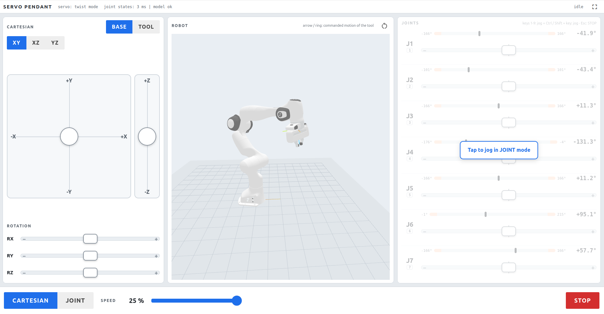

# Servo Pendant Webgui

Touch-friendly webgui for MoveIt Servo (light / dark theme, scalable), laid out like a robot teach pendant, made with [NiceGUI](https://nicegui.io)



(PolyScope-style): tool jogging left, robot centre, joints right, mode and speed at the bottom. Publishes joint jog
(`control_msgs/JointJog`) and twist (`geometry_msgs/TwistStamped`) commands. One screen, no scrolling, works with
mouse, touch and keyboard.

## Install

```bash
python3 -m venv .venv --system-site-packages
source .venv/bin/activate
pip install nicegui trimesh pycollada yourdfpy
colcon build --symlink-install servo_pendant_webgui
```

## Run

```bash
export PYTHONPATH=$(pwd)/.venv/lib/python3.12/site-packages:$PYTHONPATH 
source .venv/bin/activate
source install/setup.bash
```

And run the node.

```bash
ros2 run servo_pendant_webgui servo_pendant_webgui
```

Start it next to `ros2 launch *_moveit_config moveit.launch.py launch_servo:=true`. Then open http://localhost:8080 on any browser / tablet. 

## Panel

- **Bottom bar**:
  - **CARTESIAN / JOINT** switches the active side and Servo's command type (`/servo_node/switch_command_type`).
    Tapping the dimmed side does the same. Servo is switched again automatically whenever it (re)appears.
  - **SPEED** scales every command (default 30 %).
  - **STOP** releases all inputs. This is a software stop, not an emergency stop.
- **Joints (right)**: one row per joint from `/joint_states` (finger joints excluded).
  - The current angle, and its position between the joint's min / max limits from the URDF.
  - A spring-return velocity slider. Touch anywhere on it and drag: the drag distance is the velocity, so touching
    never jumps to speed.
- **Keyboard (joint mode)**:
  - **1 … 9**: jog joint 1 … 9 positive while held. Add **Ctrl** (or **Shift**) to jog negative. **Esc**: STOP.
  - Plain typing is swallowed, so the browser's find-as-you-type / quick find never opens.
  - Some browsers reserve Ctrl+1 … 8 for switching tabs. Use Shift, or the full-screen button (top right), which also
    locks the keyboard to the page.
- **Cartesian (left)**:
  - **BASE / TOOL**: frame of the commands (`panda_link0` / `panda_link8`).
  - **XY / XZ / YZ**: the plane the large pad moves in. The rocker next to it drives the third axis.
  - **RX / RY / RZ**: velocity sliders for rotation about the axes of the selected frame.
  - The pad and rocker are relative too: drag from wherever you touch.
- **Robot (centre)**: the robot from `/robot_description` with its URDF visual meshes (converted to glTF once and
  cached in `~/.cache/servo_pendant_webgui`).
  - Joint mode: a labelled ring shows each joint's positive direction. The moving one is coloured.
  - Cartesian mode: an arrow and/or ring at the tool shows the commanded motion.
  - Blue = positive, orange = negative. The arrow head of a moving joint's ring points in its direction of motion.
  - A loading overlay is shown until the robot description has arrived and all meshes are loaded in the browser.
- **Top right**: light / dark theme, settings and full screen.
- **Settings** (gear, top right): an overlay with every setting, grouped:
  - **Interface**: theme and UI scale (60 … 160 %). Kept per browser (cookies).
  - **Robot control**: base / tool frame (links of the URDF, or any name), max speeds, `input_timeout`,
    `publish_rate`, `exclude_joints`. Applied at once to every connected panel (they are node parameters).
  - **Topics & services**, **web server**: the read-only node parameters.
  - **MoveIt Servo**: Servo's parameters (`moveit_servo.*`: move group, command out topic, ...), read from its node
    (`/servo_node`, from `switch_command_type_service`). Read-only.
  - **ROS**: node name, `ROS_DOMAIN_ID`, RMW implementation, discovery range. Fixed when the node starts.
  - Keyboard jogging is off while the settings are open.
- **Status line (top)**: Servo mode, the age of the joint states, and a warning if more than one node publishes
  `/joint_states` (cross-talk, e.g. another robot in the same ROS domain). Joint states with a timestamp older than
  the newest one received are ignored.

The response is quadratic: fine motion near the centre, full speed at the edge.

## Safety

Commands are only sent while a control is touched or a key is held. Each control sends a heartbeat every 50 ms. An
input that is not refreshed for `input_timeout` (0.3 s) counts as released. All inputs are also released when the
window loses focus or any browser disconnects. So a lost connection, a closed tab or a frozen browser cannot leave the
robot moving. Joint jog commands always carry all joints, so a joint released a moment ago is commanded 0
explicitly. After a release, three zero commands are sent, then the stream stops.

## Parameters

| Parameter | Default |
| --- | --- |
| `port`, `host` | `8080`, `0.0.0.0` |
| `max_linear_speed` [m/s], `max_angular_speed` [rad/s], `max_joint_speed` [rad/s] (at 100 % speed) | `0.1`, `0.5`, `0.5` |
| `base_frame`, `tool_frame` | `panda_link0`, `panda_link8` |
| `twist_topic`, `joint_jog_topic` | `/servo_node/delta_twist_cmds`, `/servo_node/delta_joint_cmds` |
| `joint_states_topic`, `robot_description_topic` | `/joint_states`, `/robot_description` |
| `switch_command_type_service` | `/servo_node/switch_command_type` |
| `publish_rate` [Hz], `input_timeout` [s] | `50`, `0.3` |
| `exclude_joints` (regexes) | `['.*finger.*']` |

The frames, speeds, `publish_rate`, `input_timeout` and `exclude_joints` can be changed while the node runs, in the
settings or with `ros2 param set` (all held inputs are released on a change). The topics, the service, `host` and
`port` are read-only: set them at launch.
