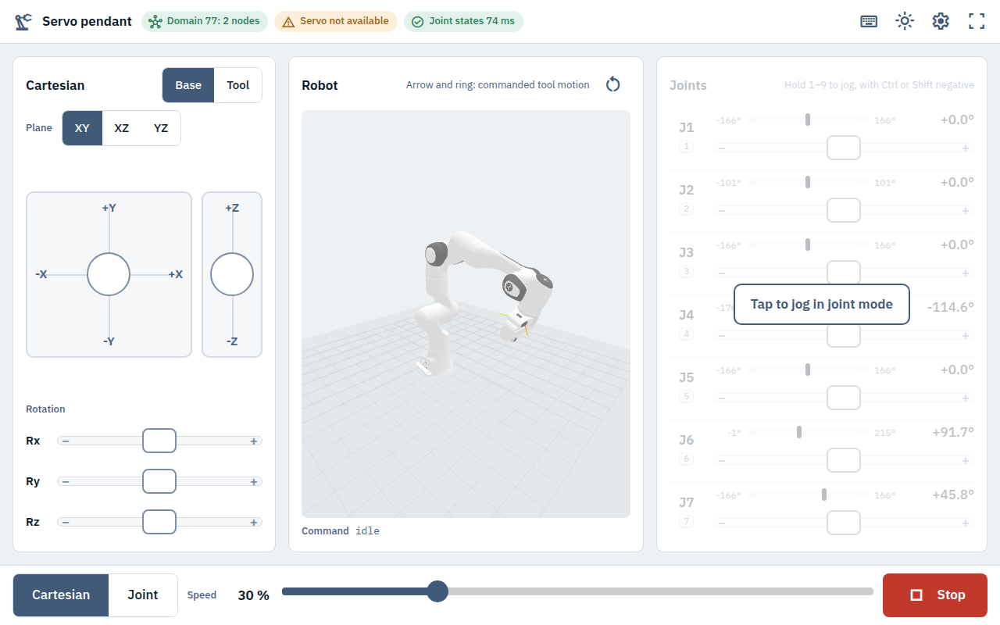

# Servo pendant webgui

Touch-friendly web teach pendant for MoveIt Servo, made with [NiceGUI](https://nicegui.io) as a ROS 2 package: light /
dark theme, keyboard shortcuts, runs without internet access. Laid out like a robot teach pendant (PolyScope style):
Cartesian jogging left, the robot in the middle, the joints right, mode, speed and STOP at the bottom. Publishes joint
jog (`control_msgs/JointJog`) and twist (`geometry_msgs/TwistStamped`) commands. One screen without scrolling from
1280×800, and it works with mouse, touch and keyboard.



## Build

```bash
pixi run colcon build --symlink-install --packages-select servo_pendant_webgui
```

NiceGUI, trimesh, pycollada and yourdfpy come from pip (`[pypi-dependencies]` of the workspace `pixi.toml`). Without
pixi: `pip install nicegui trimesh pycollada yourdfpy` in a venv made with `--system-site-packages`.

## Run

Start it next to `ros2 launch *_moveit_config moveit.launch.py launch_servo:=true`:

```bash
ros2 run servo_pendant_webgui servo_pendant_webgui                    # http://localhost:<the port it prints>
ros2 run servo_pendant_webgui servo_pendant_webgui --port 8095 --domain-id 3
pixi run servo_webgui                                                 # the same, as a pixi task
```

Then open the address it prints (the first free port from 8080, or the robot PC's address) on any browser or tablet.

| Option | Default | |
| --- | --- | --- |
| `--port` | first free from 8080 | web server port; without it the webgui takes the first free port from 8080 upwards (so several run side by side), with it a taken port stops the start |
| `--host` | `0.0.0.0` | `127.0.0.1`: only reachable from this computer |
| `--domain-id` | saved, else `ROS_DOMAIN_ID` | ROS domain of the webgui's node |
| `--namespace` | saved, else none | ROS namespace of the node |

ROS parameters: `--ros-args -p name:=value`, see [Parameters](#parameters). The web server options used to be the ROS
parameters `host` and `port`; they are command line options now.

## Panel

- **Header**: the ROS connection (click: settings), Servo's state (mode accepted, rejected or not available), the age
  of the joint states, and a red chip when more than one node publishes `/joint_states` (cross-talk, e.g. another
  robot in the same ROS domain; click it for the node names). Joint states with a timestamp older than the newest one
  received are ignored.
- **Action bar (bottom)**:
  - **Cartesian / Joint** switches the active side and Servo's command type (`/servo_node/switch_command_type`).
    Tapping the dimmed side does the same. Servo is switched again automatically whenever it (re)appears.
  - **Speed** scales every command (default 30 %).
  - **Stop** releases all inputs. This is a software stop, not an emergency stop.
- **Joints (right)**: one row per joint from `/joint_states` (finger joints hidden).
  - The current angle, and its position between the joint's min / max limits from the URDF.
  - A spring-return velocity slider. Touch anywhere on it and drag: the drag distance is the velocity, so touching
    never jumps to speed.
- **Cartesian (left)**:
  - **Base / Tool**: frame of the commands (`panda_link0` / `panda_link8`).
  - **Plane XY / XZ / YZ**: the plane the large pad moves in. The rocker next to it drives the third axis.
  - **Rotation Rx / Ry / Rz**: velocity sliders for rotation about the axes of the selected frame.
  - The pad and rocker are relative too: drag from wherever you touch.
- **Robot (centre)**: the robot from `/robot_description` with its URDF visual meshes (converted to glTF once and
  cached in `~/.cache/servo_pendant_webgui`).
  - Joint mode: a labelled ring shows each joint's positive direction. The moving one is coloured.
  - Cartesian mode: an arrow and / or ring at the tool shows the commanded motion.
  - Steel blue = positive, amber = negative. The arrow head of a moving joint's ring points in its direction of motion.
  - A loading overlay is shown until the robot description has arrived and all meshes are loaded in the browser.
  - Below the view: the command currently sent to Servo.

The response is quadratic: fine motion near the centre, full speed at the edge.

## Settings

Top right, or <kbd>Ctrl</kbd>+<kbd>,</kbd>:

- **Appearance** (this browser): light, dark or system theme. For a larger or smaller panel use the browser zoom
  (<kbd>Ctrl</kbd>+<kbd>+</kbd> / <kbd>-</kbd>).
- **ROS connection** (the whole webgui): domain ID, namespace, discovery range, static peers. *Apply and reconnect*
  restarts the webgui's ROS node with the new settings; they are saved in `~/.ros/servo_pendant_webgui/settings.json`.
- **Frames and joints**: base and tool frame (links of the URDF, or any name) and the hidden joints (regular
  expressions). Applied at once to every open page; held inputs are released.
- **MoveIt Servo**: Servo's parameters (`moveit_servo.*`: move group, command out topic, ...), read from its node
  (`/servo_node`, from `switch_command_type_service`). Read-only.
- **Parameters**: all node parameters, changed live (same as `ros2 param set`). Topics and the service are read-only.
- **About**: node name, ROS distribution, middleware, web address.

Keyboard jogging is off while the settings are open.

## Keyboard shortcuts

<kbd>?</kbd> lists all of them.

| Key | |
| --- | --- |
| <kbd>1</kbd> … <kbd>9</kbd> (held, joint mode) | jog joint 1 … 9 positive; with <kbd>Ctrl</kbd> or <kbd>Shift</kbd> negative |
| <kbd>Esc</kbd> | stop: release all inputs |
| <kbd>C</kbd> / <kbd>J</kbd> | Cartesian / joint mode |
| <kbd>+</kbd> / <kbd>-</kbd> | speed +5 % / −5 % |
| <kbd>B</kbd> / <kbd>T</kbd> | commands in the base / tool frame |
| <kbd>P</kbd> | next plane of the pad (XY, XZ, YZ) |
| <kbd>V</kbd> | reset the 3D view |
| <kbd>?</kbd> | show the shortcuts |
| <kbd>Ctrl</kbd>+<kbd>,</kbd> | settings |
| <kbd>D</kbd> | light / dark theme |
| <kbd>F</kbd> | full screen |

Digit keys work on the top row and the numpad. Other plain typing is swallowed, so the browser's find-as-you-type /
quick find never opens. Some browsers reserve <kbd>Ctrl</kbd>+<kbd>1</kbd> … <kbd>8</kbd> for switching tabs: use
<kbd>Shift</kbd>, or full screen (<kbd>F</kbd>), which also locks the keyboard to the page.

## Safety

Commands are only sent while a control is touched or a key is held. Each control sends a heartbeat every 50 ms. An
input that is not refreshed for `input_timeout` (0.3 s) counts as released. All inputs are also released when the
window loses focus or any browser disconnects. So a lost connection, a closed tab or a frozen browser cannot leave the
robot moving. Joint jog commands always carry all joints, so a joint released a moment ago is commanded 0
explicitly. After a release, three zero commands are sent, then the stream stops.

## Parameters

| Parameter | Default |
| --- | --- |
| `max_linear_speed` [m/s], `max_angular_speed` [rad/s], `max_joint_speed` [rad/s] (at 100 % speed) | `0.1`, `0.5`, `0.5` |
| `base_frame`, `tool_frame` | `panda_link0`, `panda_link8` |
| `twist_topic`, `joint_jog_topic` | `/servo_node/delta_twist_cmds`, `/servo_node/delta_joint_cmds` |
| `joint_states_topic`, `robot_description_topic` | `/joint_states`, `/robot_description` |
| `switch_command_type_service` | `/servo_node/switch_command_type` |
| `publish_rate` [Hz], `input_timeout` [s] | `50`, `0.3` |
| `exclude_joints` (regexes) | `['.*finger.*']` |

The frames, speeds, `publish_rate`, `input_timeout` and `exclude_joints` can be changed while the node runs, in the
settings or with `ros2 param set` (all held inputs are released on a change). The topics and the service are
read-only: set them at launch.
