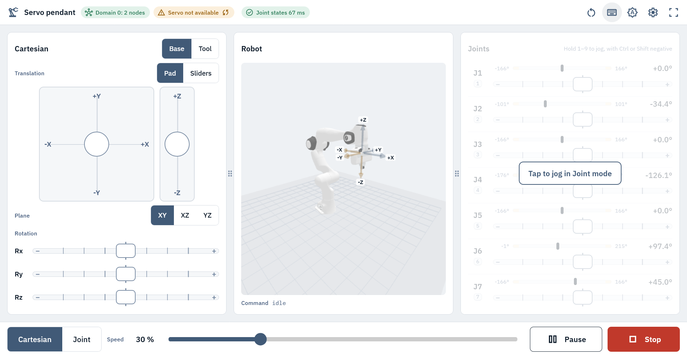
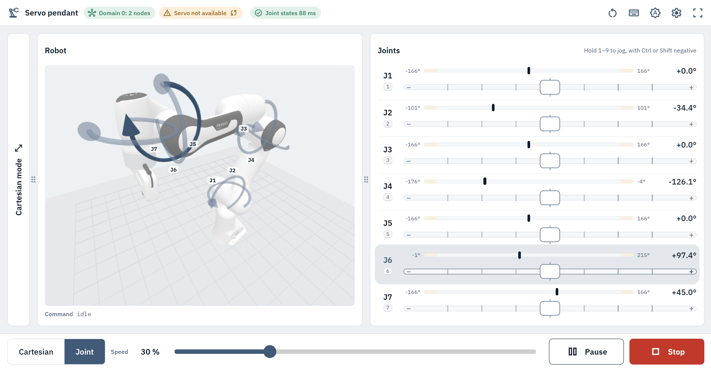

# Servo pendant webgui

Touch-friendly web teach pendant for MoveIt Servo, made with [NiceGUI](https://nicegui.io) as a ROS 2 package: light /
dark theme, keyboard shortcuts, runs without internet access. Laid out like a robot teach pendant (PolyScope style):
Cartesian jogging left, the robot in the middle, the joints right, mode, speed and STOP at the bottom. Publishes joint
jog (`control_msgs/JointJog`) and twist (`geometry_msgs/TwistStamped`) commands. One screen without scrolling from
1280×800, and it works with mouse, touch and keyboard.





## Build

```bash
pixi run colcon build --symlink-install --packages-select servo_pendant_webgui
```

NiceGUI, trimesh, pycollada and yourdfpy come from pip (`[pypi-dependencies]` of the workspace `pixi.toml`). Without
pixi: `pip install nicegui trimesh pycollada yourdfpy` in a venv made with `--system-site-packages`.

## Run

Start it next to `ros2 launch *_moveit_config moveit.launch.py launch_servo:=true`:

```bash
ros2 run servo_pendant_webgui servo_pendant_webgui                    # http://localhost:<the port it prints>
ros2 run servo_pendant_webgui servo_pendant_webgui --port 8095 --domain-id 3
pixi run servo_webgui                                                 # the same, as a pixi task
```

Then open the address it prints (the first free port from 8080, or the robot PC's address) on any browser or tablet.

| Option | Default | |
| --- | --- | --- |
| `--port` | first free from 8080 | web server port; without it the webgui takes the first free port from 8080 upwards (so several run side by side), with it a taken port stops the start |
| `--host` | `0.0.0.0` | `127.0.0.1`: only reachable from this computer |
| `--domain-id` | saved, else `ROS_DOMAIN_ID` | ROS domain of the webgui's node |
| `--namespace` | saved, else none | ROS namespace of the node |
| `--node-name` | saved, else `servo_pendant_webgui` | ROS name of the node |

ROS parameters: `--ros-args -p name:=value`, see [Parameters](#parameters). The web server options used to be the ROS
parameters `host` and `port`; they are command line options now.

## Panel

The page fills the browser width. Cartesian, robot and joints start a third of the width each. Drag the handle
(⋮⋮) in the gap between two panels to resize them: the left one moves only the border between Cartesian and robot,
the right one only the border between robot and joints; the panel on the far side keeps its width. Dragged narrower
than 250 px, the Cartesian or joints panel becomes a strip that only says *Cartesian mode* / *Joint mode*, written
vertically: tap it to bring the panel back at its size and switch to that mode (or drag its border out again).
Double-click a handle for three equal panels again; the reset button in the header (<kbd>V</kbd>) also resets the 3D
view. The sizes are kept until the page is reloaded. Below 1100 px one column is
shown: the control of the active mode (Cartesian or joints; switch with the action bar), and the robot below it.

- **Header**: the ROS connection (click: settings), Servo's state (mode accepted, rejected, paused or not available;
  click: send the command type to Servo again, see [Servo's command type](#servos-command-type)), Servo's own status
  from `/servo_node/status` when it is not *no warning* (amber while slowing down for a singularity or a collision,
  red when halted or at a joint limit; its message is shown over the 3D view), the age of the joint states, and a red chip when more than one node publishes `/joint_states` (cross-talk, e.g. another
  robot in the same ROS domain; click it for the node names). Joint states with a timestamp older than the newest one
  received are ignored.
- **Action bar (the footer, always at the bottom of the window)**:
  - **Cartesian / Joint** switches the active side and Servo's command type (`/servo_node/switch_command_type`).
    Tapping the dimmed side does the same. Tapping the mode that is already active sends the type to Servo again.
  - **Pause** stops the jog and pauses Servo (`/servo_node/pause_servo`, `true`): both sides are dimmed, the 3D
    view shows no rings or arrows, and nothing is sent. Choosing a mode (a side, a mode button or key) resumes Servo
    (`false`) in that mode; **Pause** again resumes the mode from before. The pendant **starts paused**, without
    calling the service: merely opening it must not pause Servo for another client, such as a planner.
  - **Speed** scales every command (default 30 %).
  - **Stop** releases all inputs. This is a software stop, not an emergency stop.
- **Joints (right)**: one row per joint from `/joint_states` (finger joints hidden).
  - The current angle, and its position between the joint's min / max limits from the URDF.
  - A spring-return velocity slider. Touch anywhere on it and drag: the drag distance is the velocity, so touching
    never jumps to speed.
- **Cartesian (left)**:
  - **Base / Tool**: frame of the commands (`panda_link0` / `panda_link8`).
  - **Translation Pad / Sliders**: how X, Y and Z are jogged. *Pad*: a large 2D pad in a plane and a rocker next to
    it for the third axis, with **Plane XY / XZ / YZ** below the pad choosing that plane. *Sliders*: one velocity
    slider each for X, Y and Z. The choice is per browser and kept until the page is reloaded.
  - **Rotation Rx / Ry / Rz**: velocity sliders for rotation about the axes of the selected frame.
  - The pad and rocker are relative too: drag from wherever you touch.
- **Robot (centre)**: the robot from `/robot_description` with its URDF visual meshes (converted to glTF once and
  cached in `~/.cache/servo_pendant_webgui`).
  - Joint mode: a labelled ring shows each joint's positive direction. The moving one is coloured.
  - Cartesian mode: six see-through arrows at the tool (+X, −X, +Y, −Y, +Z, −Z) show the jog directions in the
    selected frame (base or tool). The commanded ones turn solid, and a ring at the tool shows a commanded rotation.
  - Rings and arrows are drawn over the robot, so the ones behind it or inside the gripper stay visible.
  - Steel blue = positive, amber = negative. The arrow head of a moving joint's ring points in its direction of motion.
  - Pointing at a ring or arrow (mouse) or tapping it turns it solid and highlights the control that drives it: the
    joint's row, the half of the pad or rocker for that direction, or (translation with sliders) the axis' slider.
    With the pad, tapping an arrow also switches to the plane whose rocker drives that axis alone (X: YZ, Y: XZ,
    Z: XY). A tapped control stays highlighted for 2.5 s. Nothing
    moves from the 3D view: jogging stays on the controls.
  - A loading overlay is shown until the robot description has arrived and all meshes are loaded in the browser.
  - Below the view: the command currently sent to Servo.

The response is quadratic: fine motion near the centre, full speed at the edge.

## Settings

An overlay with tabs, from the gear top right, the ROS chip, or <kbd>Ctrl</kbd>+<kbd>,</kbd>:

- **ROS** (the whole webgui): domain ID, discovery range, static peers, node name, namespace. *Apply and restart*
  restarts the webgui's ROS node with them; they are saved in `~/.ros/servo_pendant_webgui/settings.json`.
- **Web GUI** (the whole webgui, applied at once to every open page; held inputs are released). Each control is a
  node parameter: a change here sets the parameter, and a `ros2 param set` shows up here at once.
  - **Topics and services**: joint states, robot description, Cartesian and joint commands, and Servo's command
    type service. Each is a dropdown of the topics (services) of its type found in the ROS graph; type any other
    name and press Enter (e.g. `/isaac_joint_states`). A new robot description topic keeps the robot shown until
    its description arrives.
  - **Frames and joints**: base and tool frame (links of the URDF, or any name) and the hidden joints (regular
    expressions).
  - **MoveIt Servo**: Servo's parameters (`moveit_servo.*`: move group, command out topic, ...), read from its node
    (`/servo_node`, from the command type service). Read-only.
  - **Parameters**: the other node parameters (speeds, publish rate, input timeout).
- **Appearance** (this browser): light, dark or system theme, text size and spacing (`?text=larger` in the address
  for a kiosk). Browser zoom (<kbd>Ctrl</kbd>+<kbd>+</kbd> / <kbd>-</kbd>) works too.
- **About**: what the pendant is, its version and address, start options, ROS and software facts.

Keyboard jogging is off while the settings are open.

## Keyboard shortcuts

<kbd>?</kbd> lists all of them. The defaults:

| Key | |
| --- | --- |
| <kbd>1</kbd> … <kbd>9</kbd> (held, joint mode) | jog joint 1 … 9 positive; with <kbd>Ctrl</kbd> or <kbd>Shift</kbd> negative |
| <kbd>Esc</kbd> | stop: release all inputs |
| <kbd>C</kbd> / <kbd>J</kbd> | Cartesian / joint mode (resumes Servo when paused) |
| <kbd>Space</kbd> | pause Servo / resume the mode from before |
| <kbd>+</kbd> / <kbd>-</kbd> | speed +5 % / −5 % |
| <kbd>B</kbd> / <kbd>T</kbd> | commands in the base / tool frame |
| <kbd>P</kbd> | next plane of the pad (XY, XZ, YZ) |
| <kbd>S</kbd> | translation with the pad or with X / Y / Z sliders |
| <kbd>V</kbd> | reset the layout (three equal panels) and the 3D view |
| <kbd>?</kbd> | show the shortcuts |
| <kbd>Ctrl</kbd>+<kbd>,</kbd> | settings |
| <kbd>D</kbd> | light / dark theme |
| <kbd>F</kbd> | full screen |

### Changing them

The keys of the actions are a table in [`config/shortcuts.yaml`](config/shortcuts.yaml), one line per action:

```yaml
pause: space          # pause Servo / resume the mode from before
faster: "+"           # speed +5 %
base: b               # commands in the base frame
```

Change a key, save and reload the page: the file is read whenever a page is opened (installed with
`colcon build --symlink-install`, the installed file is a link to the one in `src`, so no rebuild is needed). Keys are
the browser's names in lower case (`c`, `"+"`, `space`, `enter`, `arrowup`, `f2`), with modifiers in front
(`ctrl+s`, `alt+p`, `shift+p`); quote characters such as `"+"` and `"-"`, and use `""` for no shortcut. A line that
cannot be used (unknown action or key, a key used twice, or one of the fixed keys) is skipped, and the page and the
log say why. Fixed, not in the table: <kbd>Esc</kbd>, <kbd>1</kbd> … <kbd>9</kbd>, and the web GUI's own
<kbd>?</kbd>, <kbd>Ctrl</kbd>+<kbd>,</kbd>, <kbd>D</kbd> and <kbd>F</kbd>.

A button clicked or tapped gives the keyboard focus back to the page, so <kbd>Space</kbd> pauses rather than pressing
that button again.

Digit keys work on the top row and the numpad. Other plain typing is swallowed, so the browser's find-as-you-type /
quick find never opens. Some browsers reserve <kbd>Ctrl</kbd>+<kbd>1</kbd> … <kbd>8</kbd> for switching tabs: use
<kbd>Shift</kbd>, or full screen (<kbd>F</kbd>), which also locks the keyboard to the page.

## Servo's command type

MoveIt Servo only accepts commands of the type it was last switched to, and logs *Command type has not been set,
cannot accept input* for every other one. Servo has no service to ask for its current type, and other clients (e.g.
a planner that moves the robot through Servo) switch it for themselves. So the pendant sends the type of its mode:

- when Servo's service (re)appears while a mode is chosen (the pendant starts paused, with none),
- on every mode button, mode key and tap on the dimmed side, also for the mode that is already active,
- whenever a jog starts, and every second while jogging; the first command waits for Servo's answer (at most 0.5 s),
- at once when Servo logs that warning while the pendant jogs (read from `/rosout`): at most one command is lost,
- on a click on the Servo chip in the header, by hand.

It is not sent while the pendant is idle, so it never takes Servo from another client that uses it meanwhile.

## Safety

Commands are only sent while a control is touched or a key is held. Each control sends a heartbeat every 50 ms. An
input that is not refreshed for `input_timeout` (0.3 s) counts as released. All inputs are also released when the
window loses focus or any browser disconnects. So a lost connection, a closed tab or a frozen browser cannot leave the
robot moving. Joint jog commands always carry all joints, so a joint released a moment ago is commanded 0
explicitly. After a release, three zero commands are sent, then the stream stops.

## Parameters

| Parameter | Default |
| --- | --- |
| `max_linear_speed` [m/s], `max_angular_speed` [rad/s], `max_joint_speed` [rad/s] (at 100 % speed) | `0.1`, `0.5`, `0.5` |
| `base_frame`, `tool_frame` | `panda_link0`, `panda_link8` |
| `twist_topic`, `joint_jog_topic` | `/servo_node/delta_twist_cmds`, `/servo_node/delta_joint_cmds` |
| `joint_states_topic`, `robot_description_topic` | `/joint_states`, `/robot_description` |
| `switch_command_type_service` | `/servo_node/switch_command_type` |
| `pause_servo_service` (`std_srvs/SetBool`) | `/servo_node/pause_servo` |
| `servo_status_topic` (`moveit_msgs/ServoStatus`) | `/servo_node/status` |
| `publish_rate` [Hz], `input_timeout` [s] | `50`, `0.3` |
| `exclude_joints` (regexes) | `['.*finger.*']` |

All of them can be changed while the node runs, in the settings or with `ros2 param set` (all held inputs are
released on a change; a new joint states topic starts the joint list over).
